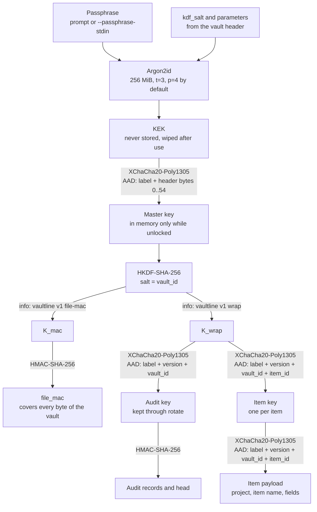
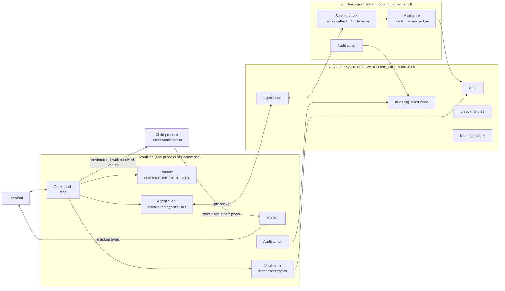
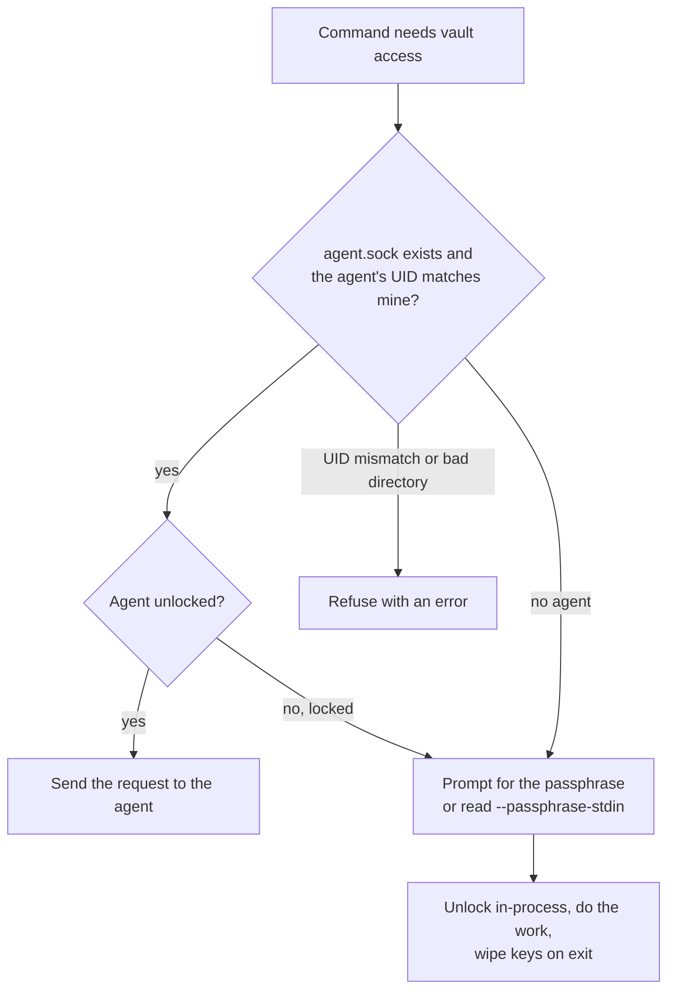
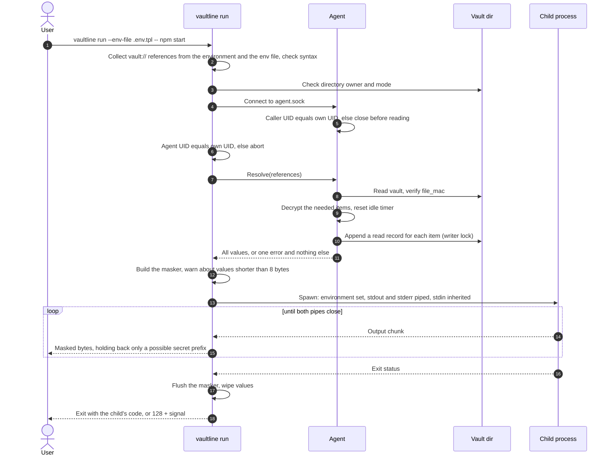
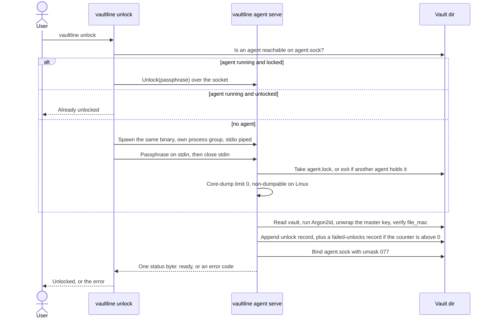
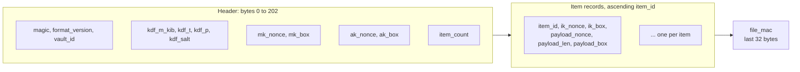
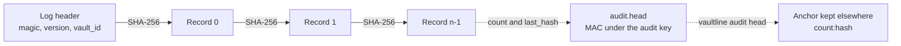

# Architecture

How vaultline is put together: the key hierarchy, the components, the main sequences and where everything lives on disk. The byte-level formats are in `vault-format.md`, behaviour and invariants in `design.md`, and the reasons for each choice in `decisions.md`.

## 1. Key hierarchy



| Operation | Changes | Leaves alone |
|---|---|---|
| `passwd` | salt, KEK, the wrap of the master key | master key, audit key, item keys, item ciphertext |
| `rotate` | salt, KEK, master key, every item key, every item ciphertext (fresh nonces) | `vault_id`, every `item_id`, the audit key (re-wrapped under the new master key) |

(D-004, D-034)

## 2. Components



- **Commands** decide where each request goes. If an agent is reachable and passes the UID check, the request goes to the agent. Otherwise the command prompts for the passphrase and does the work in-process, and the key is wiped when the command exits (D-014).
- **The vault core** is the same library code in both paths: it encodes and decodes the vault format, derives keys, and seals and opens items.
- **The agent** holds the master key and decrypts on request. It returns only the field values asked for, and the master key never leaves its process (D-014).
- **The masker** sits between the child's output pipes and the terminal (D-007, D-009).
- **Audit writers** append records under the writer lock, whichever process is doing the work (D-015, D-016, D-030).

### Where a command's request goes



A locked agent stays locked. The command does its own work in-process, and the agent's state doesn't change. `init`, `passwd` and `rotate` always run in-process and always ask for the current passphrase, even when an agent is unlocked, so nobody at an unlocked terminal can change the keys. After `rotate`, the command tells a running agent to lock, because the agent's master key is now out of date. `passwd` doesn't change the master key, so the agent keeps working.

## 3. `vaultline run` through the agent



Without an agent, steps 4 to 10 are replaced by an in-process unlock: Argon2id, unwrapping the master key, verifying the file MAC and decrypting the items, with the `unlock` and `read` records appended directly.

## 4. Unlocking and starting the agent



The passphrase never appears in the agent's arguments or environment (D-012, D-014). The agent ignores SIGHUP. Ctrl-C in the terminal doesn't reach it, because it runs in its own process group. It wipes the master key on `vaultline lock`, on `vaultline agent stop`, on SIGTERM or SIGINT sent to it directly, and after the idle timeout, which is 15 minutes by default (D-013). On idle timeout or stop, it also removes `agent.sock` and exits.

## 5. Vault file layout



| Region | Encrypted | Authenticated by |
|---|---|---|
| magic, version, `vault_id`, KDF parameters, salt | no | the associated data of `mk_box`, and `file_mac` |
| `mk_box` | yes, under the KEK | its AEAD tag |
| `ak_box`, `ik_box` | yes, under `K_wrap` | their AEAD tags, and `file_mac` |
| `item_count`, record framing | no | `file_mac` |
| `payload_box`: names and values | yes, under the item key | its AEAD tag, and `file_mac` |

## 6. Audit chain



Each record holds the SHA-256 of the record before it and an HMAC under the audit key. The head records how many entries exist, and an anchor saved outside the vault catches a rollback of the log and head together (D-015).

## 7. Files and directories

| Path, under `~/.vaultline` or `$VAULTLINE_DIR` | Mode | Holds | Written by |
|---|---|---|---|
| directory | 0700 | everything below; owner and mode checked before every use | `init` |
| `vault` | 0600 | the vault (`vault-format.md` §4) | `init`, `set`, `rm`, `passwd`, `rotate` |
| `audit.log` | 0600 | audit records (§5.1–5.3) | any command that unlocks, reads or writes, and the agent |
| `audit.head` | 0600 | audit head (§5.4) | the same |
| `unlock-failures` | 0600 | unauthenticated count of failed unlocks (§5.5) | failed unlocks |
| `lock` | 0600 | empty; held with `flock` while writing | every writer |
| `agent.lock` | 0600 | empty; held with `flock` for as long as an agent runs | the agent |
| `agent.sock` | socket | the agent's endpoint | the agent |
| `.vault.tmp-*`, `.audit.head.tmp-*` | 0600 | ciphertext only, during an atomic replace | writers |

Nothing outside this directory is ever written. Plaintext secrets go only to the child's environment (`run`) or to stdout (`get`, `inject`), and stdout is refused when it is a regular file (D-010, D-011).

## 8. Source layout (created in Phase 1)

```
src/
  main.rs         clap command tree, exit codes
  lib.rs          #![forbid(unsafe_code)], modules
  paths.rs        VAULTLINE_DIR, directory owner and mode checks
  hardening.rs    core-dump limit, non-dumpable on Linux
  secret.rs       secret wrapper types (no Debug or Display)
  vault/
    mod.rs        create, open, set, rm, list, passwd, rotate
    format.rs     v1 encoder and decoder
    crypto.rs     Argon2id, HKDF, AEAD, file MAC
    store.rs      atomic replace, writer lock
  inject/
    reference.rs  vault://project/item/field parser
    envfile.rs    --env-file parser
    template.rs   {{ vault://... }} parser and renderer
    mask.rs       streaming masker
    run.rs        child process, pipes, signals
    output.rs     refusal when stdout is a regular file
  agent/
    protocol.rs   frame encoder and decoder
    server.rs     socket, peer check, idle timer
    client.rs     connect, peer check, requests
  audit.rs        records, head, append, verify, anchors
tests/
  invariants/     one file per invariant, s1_*.rs to s10_*.rs
  adversarial/    tamper, swap, truncation, socket and filesystem attacks
  fixtures/v1/    known-answer vaults (vault-format.md §7)
fuzz/             cargo-fuzz crate, outside the workspace
  fuzz_targets/   vault_file, reference, template, agent_message
benches/          criterion: unlock, run overhead
scripts/          scripts that produce every published number
```
