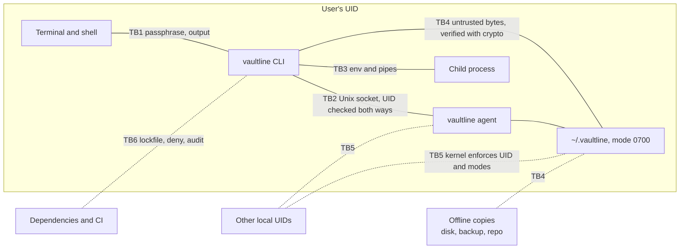

# Threat model

What vaultline protects, from whom, how, and what it deliberately doesn't protect. Every claim names its mechanism and the test that proves it (§7). Decisions are cited as D-NNN, design sections as `design.md` §N.

## 1. System and assumptions

vaultline is a single-user CLI for macOS, which is the platform used day to day. Linux is also supported and is tested in CI (D-021). The CLI keeps secrets in an encrypted vault under `~/.vaultline`, and an optional agent holds the unlocked master key behind a Unix socket. Secrets reach a child process's environment (`run`) or stdout (`get`, `inject`).

**Assumptions:**

- **A1.** The kernel, root, the hardware and the firmware are trusted.
- **A2.** The OS random number generator works.
- **A3.** The RustCrypto crates are correct, and constant-time wherever they claim to be.
- **A4.** The user's account isn't compromised: no malware runs as the user.
- **A5.** The terminal, the shell and the user's own commands are trusted.
- **A6.** The user picks a passphrase they don't use elsewhere. Length is enforced (D-029); strength beyond that isn't.
- **A7.** The OS keeps each process's environment private from other users. A child under `run` holds secrets in its environment.

## 2. Assets

| ID | Asset | Why it matters |
|---|---|---|
| AS1 | Secret values | the thing being protected |
| AS2 | Passphrase | unlocks everything |
| AS3 | KEK, master key, `K_wrap`, `K_mac`, item keys | each one unlocks part or all of AS1 |
| AS4 | Audit key | lets its holder forge audit entries |
| AS5 | Metadata: project, item and field names, how many items, their sizes | shows what is worth attacking, and how projects are laid out |
| AS6 | Integrity of the vault contents | a swapped or edited value can redirect a deployment |
| AS7 | Integrity of the audit log | answers "what touched my secret?" |

## 3. Adversaries

| ID | Adversary | Capabilities | In scope? |
|---|---|---|---|
| T1 | Offline thief | a copy of the vault directory from a stolen disk, a backup or a synced folder; unlimited offline compute; no passphrase | yes |
| T2 | Repo leak | the vault file, env files or templates published in a repository | yes |
| T3 | Other local user | a different UID on the same machine; can list processes, connect to reachable sockets and read world-readable files | yes |
| T4 | Accidental exposure | the user, or the user's tools, put secrets into logs, CI output, shell history, screen shares or `.env` files | yes |
| T5 | Offline tamperer | can change, roll back or delete files in the vault directory while the user is away (for example through a synced folder or a restored backup); no passphrase | yes, for integrity |
| T6 | Supply chain | a malicious or vulnerable dependency | partly: known advisories and banned crates only |
| T7 | Malware running as the user | everything the user can do | no (§5) |
| T8 | Root, the kernel, physical memory access | everything | no (§5) |

## 4. Trust boundaries

| Boundary | What crosses it | What vaultline relies on |
|---|---|---|
| TB1 terminal and CLI | passphrase in; values out (`get`, `inject`, unmasked bytes) | A5; the prompt has echo off |
| TB2 CLI and agent | requests, values, passphrase (Unlock) | directory 0700; UID check on both ends; size-bounded frames (`design.md` §8) |
| TB3 CLI and child | values in the environment; output back through pipes | the child is trusted with the secrets it receives, and nothing more |
| TB4 processes and files | ciphertext, audit records | contents are treated as hostile until authenticated (`vault-format.md` §4.7) |
| TB5 UID boundary | nothing, by design | kernel enforcement of file modes and peer credentials |
| TB6 build | dependency code | pinned `Cargo.lock`, cargo-deny, cargo-audit |

## 5. Out of scope, and why

| Threat | Why it is out of scope |
|---|---|
| **T7: malware running as the user** | It can keylog the passphrase, ask the agent for any secret (it passes the UID check), read the child's environment, or replace the `vaultline` binary. No tool running in the user's own account can defend against code with the same rights. The answer is OS sandboxing and endpoint security. `ssh-agent` draws the same line. Partial mitigations exist anyway: the passphrase is never in the environment, and on Linux the process is non-dumpable. |
| **T8: root, kernel or physical access** | Root can read any memory and replace any file. Cold-boot and DMA attacks, or reading a hibernation image, can recover an unlocked agent's key. Mitigation is limited to keeping the key in memory only while unlocked, and wiping it on lock and timeout. |
| **Reading an unlocked agent's live memory** | Covered by T7 and T8. |
| **What the child does with a secret** | Once a secret is in the child's environment, the child can log it, send it anywhere or keep it. Masking covers only the child's stdout and stderr (§6, R7). |
| **Terminal scrollback, clipboard, screen recording** after `get` or `inject` prints to a terminal | Printing to a terminal is the requested behaviour (D-011). |
| **Side channels** (timing or power on shared hardware) | Beyond relying on the constant-time primitives from RustCrypto (A3). |
| **Denial of service** by deleting or corrupting files | Anyone with the user's rights can delete the vault. Backups are the user's job. Other UIDs are kept out by the 0700 directory. |
| **Sharing, sync, cloud, Keychain or Touch ID** | Non-goals (`requirements.md` §6). |

## 6. Threats in scope and their mitigations

| Threat | Mechanism | Decision | Tests |
|---|---|---|---|
| T1/T2 reads secret values | XChaCha20-Poly1305 for every value under an item key, wrapped under a master key, wrapped under an Argon2id KEK | D-001, D-003 | S1, S4, S5; `adversarial/no_plaintext_in_vault.rs` |
| T1/T2 learns names | names exist only inside the encrypted payloads; item IDs are random | D-005 | `adversarial/no_plaintext_in_vault.rs` |
| T1/T2 guesses the passphrase | Argon2id at 256 MiB, t=3, p=4; passphrase of at least 12 characters; parameters upgraded by `passwd` | D-001, D-029 | `invariants/s4_wrong_passphrase.rs`; `cli/init.rs` (minimum length, default parameters written); the unlock bench publishes the time per guess |
| T5 edits, swaps, truncates or splices the vault | AEAD with associated data binding role, version, vault and item; HMAC over the whole file; bounded parser | D-002, D-003 | S2, S3, S10 (`vault_file` fuzz target) |
| T5 lowers the KDF cost or exhausts memory through the header | parameters inside the `mk_box` associated data and the KEK derivation; parser ceilings checked before the KDF | D-001 | `adversarial/kdf_bounds.rs` |
| T5 tampers with the audit log | SHA-256 chain, HMAC under a separate audit key, MAC'd head, anchors saved elsewhere | D-015, D-016, D-034 | S8 |
| T3 connects to the agent | socket in a 0700 directory; peer-UID check before any read; the client checks the agent's UID too | D-013 | S9; `adversarial/planted_socket.rs` |
| T3 reads the vault directory | directory 0700, files 0600, owner and mode checked before every use | D-027 | `adversarial/permissions.rs` |
| T3 sees secrets in `ps` | values never in arguments (D-011); passphrase never in arguments or environment (D-012); the agent gets the passphrase through a pipe (D-014) | D-011, D-012, D-014 | `cli/no_secret_in_argv.rs` |
| T3, or a same-UID process, on Linux, reads a vaultline process through `/proc` or ptrace | `PR_SET_DUMPABLE` set to 0 | D-017 | `cli/hardening.rs`: a child reading `/proc/$PPID/environ` gets permission denied |
| T4 secrets in `.env` files and shell history | references instead of values; env files and templates hold no secrets | D-008, D-026 | S6 |
| T4 secrets in logs and CI output | the `run` masker | D-007, D-009, D-028 | S7 |
| T4 `inject > config.yml` writes plaintext | `inject` and `get` refuse when stdout is a regular file | D-010 | `cli/output_refusal.rs` |
| T4 secrets in vaultline's own errors or crash dumps | no secret type implements Debug or Display; errors never format values; core-dump limit 0 | D-017 | every CLI test checks stderr; `adversarial/secret_types.rs` (static assertions); `cli/hardening.rs` (`ulimit -c` shows 0) |
| T4 plaintext temporary files | atomic-replace temporary files hold only ciphertext; no plaintext file is ever created | D-027 | S6 |
| T6 known-vulnerable or banned crates | pinned lockfile; cargo-deny (advisories, licenses, sources, banned networking crates); cargo-audit | D-022 | CI Linux job |

## 7. Claims and the tests that prove them

Every security statement in the README must appear here.

| # | Claim | Proven by |
|---|---|---|
| C1 | Without the passphrase, the vault file reveals no secret value and no name. | `adversarial/no_plaintext_in_vault.rs`, S1, S5 |
| C2 | Changing any byte of the vault gives an error, never wrong data or a panic. | S2, S10 |
| C3 | Ciphertext moved between items, or into another vault, fails to open. Records spliced in from another copy or an older snapshot of the same vault are rejected by the file MAC. | S3 |
| C4 | A wrong passphrase gives a clean error. | S4 |
| C5 | Vaults written by format v1 always open. | S5 |
| C6 | `run`, `inject`, `get` and `set` write no secret to disk. | S6 |
| C7 | `run` masks every occurrence of every secret in output, however it is chunked. | S7 |
| C8 | Editing, deleting, reordering or truncating audit records is detected. Rolling back log and head together is caught given an anchor. | S8 |
| C9 | Other UIDs can't use the agent, and the agent forgets the key on lock and idle timeout. | S9 |
| C10 | No parser panics on any input. | S10 |
| C11 | vaultline's processes can't write core dumps, and on Linux are non-dumpable. | `cli/hardening.rs` |
| C12 | Secrets never appear in vaultline's arguments, error messages or stderr. | `cli/no_secret_in_argv.rs`; the stderr check in every CLI test |
| C13 | The directory and files are private to the user, and vaultline refuses to use them otherwise. | `adversarial/permissions.rs` |

## 8. Residual risks

| ID | Risk | Why it is accepted, or the follow-up |
|---|---|---|
| R1 | A weak passphrase can still be guessed offline. | Argon2id raises the cost of each guess and the 12-character minimum blocks the worst choices (D-001, D-029). The README advises several random words. |
| R2 | The file reveals the vault ID, the KDF parameters, the item count, approximate item sizes and the modification time. | D-005. Size padding is a follow-up. |
| R3 | Replacing the whole vault with an older valid copy can't be detected. Neither can a joint rollback of log and head without a saved anchor. | Detecting it needs state outside the vault. Anchors close the gap for the audit log (D-015). |
| R4 | The failed-unlock counter is unauthenticated: T5 can reset it. | No key exists before an unlock succeeds (D-016). |
| R5 | Any process running as the user can query an unlocked agent. On macOS no call is made equivalent to Linux's non-dumpable setting. | Out of scope as T7. On macOS, debugger access is left to the OS's own rules. |
| R6 | Copies that zeroize can't reach: the environment block `std::process::Command` builds for the child, the masking automaton's copy of each secret, kernel pipe buffers, the child's memory, terminal scrollback, swap and hibernation files. | `design.md` §10. macOS encrypts swap by default; on Linux it depends on configuration. |
| R7 | Masking misses encoded forms, writes to `/dev/tty` and to files, and secrets split between stdout and stderr. Secrets shorter than 8 bytes produce a warning. | Masking catches accidents. It isn't a boundary against the child (D-007). |
| R8 | `vaultline inject \| cat > file` gets past the regular-file refusal. | It guards against accidents, not intent (D-010). |
| R9 | A dependency could be compromised before an advisory is published. | Few, well-known crates; pinned versions; reviewed in each PR. |
| R10 | The audit key never changes. Whoever once obtains it can forge entries. | D-034. Rotating it is a follow-up. |
| R11 | Poly1305 AEADs aren't key-committing. | No partitioning oracle exists for a local file (`design.md` §3). |
| R12 | Audit timestamps come from the system clock. | Informational only; ordering comes from `seq`. |
| R13 | A value typed as an extra argument by mistake shows up in clap's usage error and in shell history. | The value had already left through the arguments. `set` takes no value argument at all (D-011). |
| R14 | The child inherits a core-dump limit of 0. | Intended, since the child holds secrets (`design.md` §7). |
